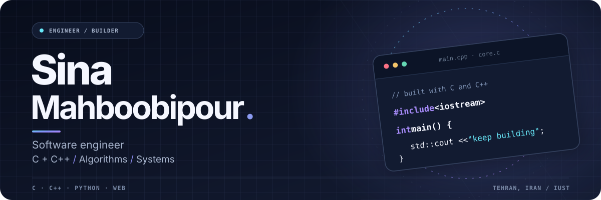

<!-- Profile README for github.com/SinaMah -->

  <picture>
    <source media="(prefers-color-scheme: dark)" srcset="./assets/hero-dark.svg" />
    <source media="(prefers-color-scheme: light)" srcset="./assets/hero-light.svg" />
    
  </picture>

   

  

   

  <strong>Building software with clarity, purpose, and attention to detail.</strong>

    

  <a href="https://sinamah.github.io">Portfolio</a> &nbsp;·&nbsp;
  <a href="https://github.com/SinaMah?tab=repositories">Repositories</a> &nbsp;·&nbsp;
  <a href="mailto:sinamahboobipour@yahoo.com">Email</a> &nbsp;·&nbsp;
  <a href="https://t.me/sinamahp">Telegram</a>

 

## About me

I'm **Sina**, a software engineer and **M.Sc. student at Iran University of Science and Technology (IUST)**.

I love solving hard problems, understanding how things work under the hood, and turning ideas into **efficient, reliable, and maintainable software**. I especially enjoy **C, C++, Python, algorithms, and systems-level thinking**.

> Thoughtful engineering is about more than making something work—it's making it understandable, fast, and worth maintaining.

## What I focus on

| Area | What interests me |
| :--- | :--- |
| **01 · C / C++ & systems** | Performance, memory, core programming fundamentals, and writing efficient code. |
| **02 · Algorithms** | Data structures, computational thinking, and elegant problem-solving. |
| **03 · Backend engineering** | Software architecture, maintainability, and robust applications. |

## Languages & tools

**Core programming languages — C · C++ · Python**

<picture>
    <source media="(prefers-color-scheme: dark)" srcset="https://skillicons.dev/icons?i=c,cpp,python&amp;theme=dark" />
    <source media="(prefers-color-scheme: light)" srcset="https://skillicons.dev/icons?i=c,cpp,python&amp;theme=light" />
    
  </picture>

**Other languages & web technologies**

<picture>
    <source media="(prefers-color-scheme: dark)" srcset="https://skillicons.dev/icons?i=js,ts,html,css&amp;theme=dark" />
    <source media="(prefers-color-scheme: light)" srcset="https://skillicons.dev/icons?i=js,ts,html,css&amp;theme=light" />
    
  </picture>

**Development tools**

<picture>
    <source media="(prefers-color-scheme: dark)" srcset="https://skillicons.dev/icons?i=git,github,linux,bash,docker,vscode,figma&amp;theme=dark" />
    <source media="(prefers-color-scheme: light)" srcset="https://skillicons.dev/icons?i=git,github,linux,bash,docker,vscode,figma&amp;theme=light" />
    
  </picture>

## Currently exploring

- **Modern C++ & C** — deeper knowledge of memory, performance, and low-level software fundamentals.
- **Algorithms & data structures** — choosing simple, effective solutions to demanding problems.
- **Backend architecture** — building systems that remain understandable as they grow.

## GitHub · live activity

These cards update from public GitHub activity; the figures may be cached by their providers.

  <picture>
    <source media="(prefers-color-scheme: dark)" srcset="https://github-readme-stats.vercel.app/api?username=SinaMah&amp;show_icons=true&amp;hide_border=true&amp;hide_title=false&amp;include_all_commits=true&amp;title_color=8FBAFF&amp;text_color=CDD8EB&amp;icon_color=A78BFA&amp;bg_color=111A2D&amp;border_radius=14" />
    <source media="(prefers-color-scheme: light)" srcset="https://github-readme-stats.vercel.app/api?username=SinaMah&amp;show_icons=true&amp;hide_border=true&amp;hide_title=false&amp;include_all_commits=true&amp;title_color=365D9D&amp;text_color=41516B&amp;icon_color=7C3AED&amp;bg_color=F2F6FF&amp;border_radius=14" />
    
  </picture>

   

  <picture>
    <source media="(prefers-color-scheme: dark)" srcset="https://github-readme-activity-graph.vercel.app/graph?username=SinaMah&amp;hide_border=true&amp;hide_title=true&amp;bg_color=111A2D&amp;color=CDD8EB&amp;line=8B89F7&amp;point=6FD4E9&amp;area=true&amp;area_color=8B89F7&amp;radius=14&amp;days=31" />
    <source media="(prefers-color-scheme: light)" srcset="https://github-readme-activity-graph.vercel.app/graph?username=SinaMah&amp;hide_border=true&amp;hide_title=true&amp;bg_color=F2F6FF&amp;color=41516B&amp;line=6766CF&amp;point=0891B2&amp;area=true&amp;area_color=A7B2FF&amp;radius=14&amp;days=31" />
    
  </picture>

### Contribution trail

  <!-- Updated daily by .github/workflows/snake.yml. The image appears after its first successful run. -->
  <picture>
    <source media="(prefers-color-scheme: dark)" srcset="https://raw.githubusercontent.com/SinaMah/SinaMah/output/github-contribution-grid-snake-dark.svg" />
    <source media="(prefers-color-scheme: light)" srcset="https://raw.githubusercontent.com/SinaMah/SinaMah/output/github-contribution-grid-snake.svg" />
    
  </picture>

## Projects

I'm documenting what I build and learn. For now, you can explore the code directly on GitHub.

**[Explore my repositories](https://github.com/SinaMah?tab=repositories)**

---

  <strong>Have a project or an interesting problem in mind?</strong>

   

  <a href="mailto:sinamahboobipour@yahoo.com">Let's talk</a> &nbsp;·&nbsp;
  <a href="https://sinamah.github.io">Visit my portfolio</a>

    

  Think deeply. Build simply. Keep improving.

